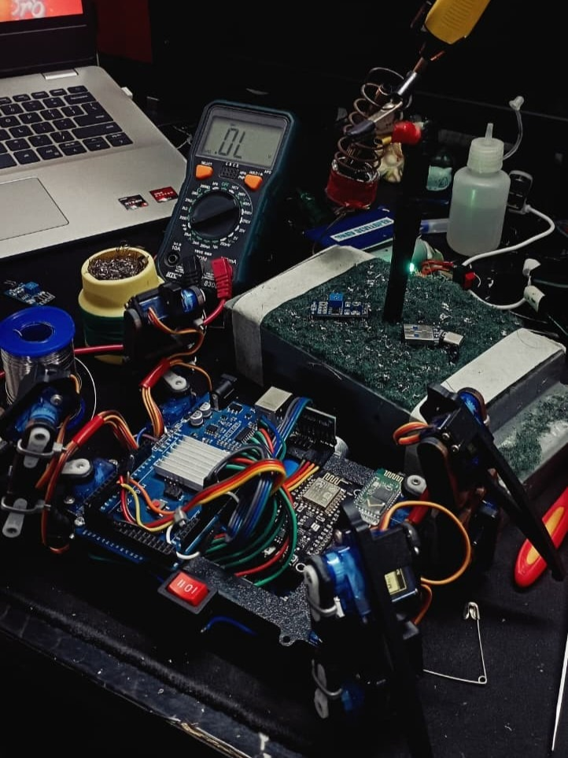

  

   

  
  
  
  

 

## ⚡ Engineering at the Silicon & Intelligence Boundary

<table>
<tr>
<td width="58%" valign="top">

### 👨‍💻 About Me
I build at the intersection of **bare-metal hardware and intelligent systems** — bridging low-level microcontroller firmware, autonomous robotics, and modern multi-agent AI pipelines.

- 🛠️ **Embedded & Firmware:** Architecting modular C++ runtime environments (like **PocketOS**) on ESP32-S3 with custom graphics drivers, NVS persistence, and hardware-level peripherals.
- 🤖 **Autonomous Robotics:** Developing camera-driven, GPS-denied autonomous navigation systems for outdoor Unmanned Ground Vehicles (**BEL Problem Statement #26126**).
- 🧠 **Applied AI & Agents:** Designing real-time multi-agent workflows (**AMD Developer Hackathon 2025**) deployed on enterprise accelerator infrastructure.
- 📍 **Focus:** Embedded Systems • Computer Vision • Autonomous Navigation • Edge AI

</td>
<td width="42%" align="center" valign="middle">

**Engineering Workbench**
  

</td>
</tr>
</table>

---

## 🚀 Flagship Engineering Projects

| Project | Domain | Architecture & Stack | Key Highlights |
|:---|:---|:---|:---|
| 📱 **[PocketOS](https://github.com/NodeNexus/POCKETOS)** | **Embedded OS / Firmware** | `C++` `ESP32-S3` `ST7735 TFT` `FreeRTOS` | Modular application-based operating environment for ESP32-S3-Zero. Features animated 3x3 launcher, persistent NVS flash settings, and custom GUI. |
| 🦯 **[UniStick.Co-Pi](https://github.com/NodeNexus/UniStick.Co-Pi)** | **IoT & Assistive Robotics** | `Python` `Raspberry Pi` `Sensors` `Twilio` | Smart IoT assistive navigation system with ultrasonic obstacle telemetry, real-time sensor processing, and emergency SMS companion. |
| 🛰️ **[VisionNav UGV](https://github.com/NodeNexus/Vision-Based-Autonomous-Navigation-for-Unmanned-Ground-Vehicle-for-Outdoor-environment)** | **Robotics & Computer Vision** | `Python` `OpenCV` `PyTorch` `Depth-Pro` | **Bharat Electronics Limited (BEL)** camera-driven autonomous navigation for outdoor UGVs in GPS-denied environments. Traversability and visual odometry. |
| 💳 **[SBETS](https://github.com/NodeNexus/SBETS)** | **Fintech & Full-Stack Systems** | `JavaScript` `Node.js` `Express` `Chart.js` | Business expense tracking platform with simulated QR/UPI payment flows, automated category budgeting, and real-time spending analytics. |

---

## 🛠️ Technical Stack & Tooling

### 🔌 Embedded Systems & Hardware

### 🧠 Robotics, Vision & Machine Learning

### 💻 Web Systems, Cloud & Tooling

---

## 📊 Contribution Activity

  

 

  Built with precision. Constantly learning, architecting, and shipping.

